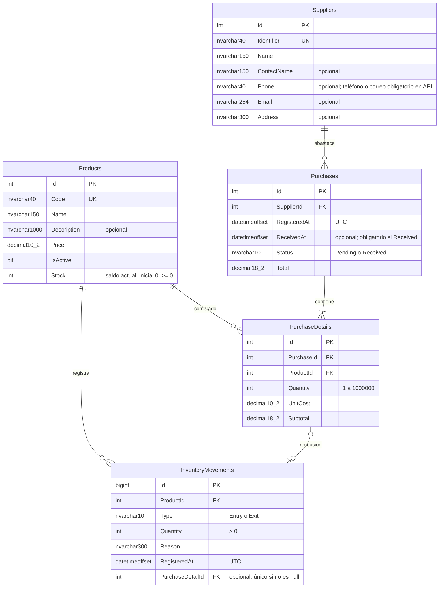

# Modelo entidad-relación — Sprints 1 y 2

`Products.Stock` es el único saldo actual. Cada movimiento registra una variación positiva y su sentido; no almacena otra copia del saldo. Desde el saldo inicial cero debe cumplirse `Stock = SUM(Entry.Quantity) - SUM(Exit.Quantity)`. La edición de catálogo no admite Stock en sus DTOs.

Un ajuste ejecuta un UPDATE condicional del saldo y un INSERT del movimiento dentro de la misma transacción SQL. La salida exige `Stock >= Quantity`; la entrada comprueba que no exceda Int32.MaxValue. Los bloqueos de actualización SQL serializan ajustes concurrentes sobre el mismo producto. Si falla el INSERT o el commit, se revierte la transacción. Un movimiento rechazado no deja cambios parciales.

Restricciones: stock no negativo; cantidad positiva; tipo Entry/Exit; código de producto único; relación con eliminación restringida. Índice de movimientos `(ProductId, RegisteredAt, Id)` para consulta de los últimos 50. No hay endpoints para editar o borrar movimientos. Una corrección se registra como un nuevo ajuste con motivo.

Migraciones: `InitialProducts` original y `AddInventory` aditiva. La segunda añade una columna con valor inicial cero, una tabla, sus restricciones e índice. Conserva los productos existentes y no intenta inferir existencias físicas: el personal debe registrar el conteo inicial como entrada. No se ejecutaron operaciones Down.

Sprint 2 añade proveedores, compras y detalles con `Sprint2SuppliersAndPurchases`: ver [migraciones](migrations.md). Crear compra guarda cabecera y detalles en la transacción automática de SaveChanges y no cambia stock. Recibir compra reclama el estado Pending con un UPDATE condicionado, luego reutiliza InventoryRepository dentro de esa misma transacción; cualquier fallo revierte estado, fecha, saldos y movimientos.

`InventoryMovements.PurchaseDetailId` nullable identifica movimientos de recepción. Un índice único filtrado impide dos movimientos por detalle, sin afectar ajustes manuales que dejan esa referencia null. Los detalles no duplican saldo: almacenan cantidades compradas y costos, mientras que `Products.Stock` sigue siendo la única existencia actual. La API no expone edición/eliminación de compras ni movimientos.
